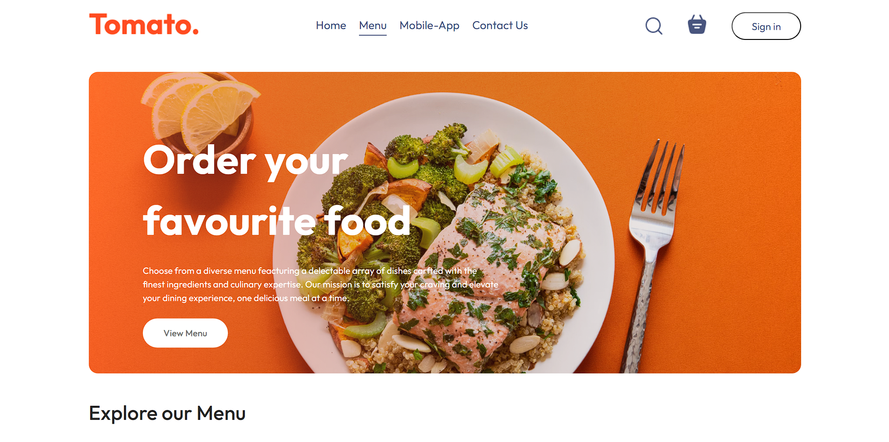

# 🍔 Food-Delivery-System



## 🚀 Overview
**Food-Delivery-System** is a modern web application for effortless food ordering and delivery. Designed for a seamless and intuitive user experience, it features an interactive UI, a dynamic menu, and an easy-to-use cart system.

Whether you're craving a quick snack or a full-course meal, our platform ensures a hassle-free ordering experience with a smooth interface, responsive design, and a fast checkout

Whether you're craving a quick snack or a full-course meal, our system ensures a hassle-free ordering experience. Enjoy a smooth interface, responsive design, and fast checkout process!

---

## 🎯 Features
✅ **User-Friendly Interface** – Easy navigation and a visually appealing design  
✅ **Dynamic Menu** – Browse through a variety of food items with real-time updates  
✅ **Add to Cart** – Easily add or remove items from the cart  
✅ **Secure Checkout** – Smooth order placement with authentication  
✅ **Responsive Design** – Works seamlessly on desktop and mobile devices  
✅ **Optimized Performance** – Fast-loading pages with animations  
✅ **Smooth Animations** – Engaging hover effects and UI transitions  
✅ **Context API Integration** – Centralized state management for better performance  

---

## 🛠️ Tech Stack
- **Frontend:**  
  ⚛ **React.js** – Component-based architecture for a seamless UI  
  🎨 **HTML5 & CSS3** – Modern styling with responsive layouts  
  🎭 **JavaScript (ES6+)** – Interactive and dynamic elements  
  💅 **CSS Modules** – Scoped styling to avoid conflicts  

- **Routing & State Management:**  
  🛣️ **React Router** – Handles client-side navigation  
  🎯 **Context API** – Manages global state efficiently  

- **Styling & Animations:**  
  🎭 **CSS Animations** – Smooth transitions and effects  
  🌐 **Google Fonts** – Enhanced typography and readability  

---

## 📦 Installation
### 1️⃣ Clone the Repository
```bash
 git clone https://github.com/FNICKE/Food-Delivery-System-main.git
 cd Food-Delivery-System-main
```

### 2️⃣ Install Dependencies
```bash
 npm install
```

### 3️⃣ Start the Development Server
```bash
 npm run dev
```
The app should now be running at `http://localhost:3000/` 🚀

---

## 📜 File Structure
📁 **src** – Contains all application components  
📁 **components** – Includes Navbar, Footer, and UI elements  
📁 **pages** – Home, Cart, and Order Placement pages  
📁 **context** – StoreContext for managing app-wide state  
📁 **assets** – Icons, images, and styles  
📄 **App.jsx** – Main application file  
📄 **main.jsx** – Application entry point  

---

## 🖥️ How to Use
1️⃣ **Browse the menu** – Explore various food items available for ordering.  
2️⃣ **Add items to cart** – Click on your favorite dish and add it to your cart.  
3️⃣ **View Cart** – Check your selected items and modify quantities.  
4️⃣ **Place Order** – Secure checkout and order confirmation.  
5️⃣ **Enjoy Your Meal!** 🍽️

---

## 🔥 Future Enhancements
🚀 **User Authentication** – Login & Sign-up functionality  
🚀 **Order Tracking** – Real-time order status updates  
🚀 **Payment Integration** – Secure online transactions  
🚀 **Admin Dashboard** – Manage orders and menu items  
🚀 **AI-Based Recommendations** – Personalized meal suggestions  

---

## 🤝 Contributing
Contributions are welcome! Feel free to fork this repo, create a new branch, and submit a pull request. Make sure to follow best practices and write clean, modular code.

---

## 📜 License
This project is licensed under the **MIT License**.

---

## 📬 Contact
For queries or suggestions, reach out at: [rathodsachin0766@gmail.com](mailto:rathodsachin0766@gmail.com)  

---


